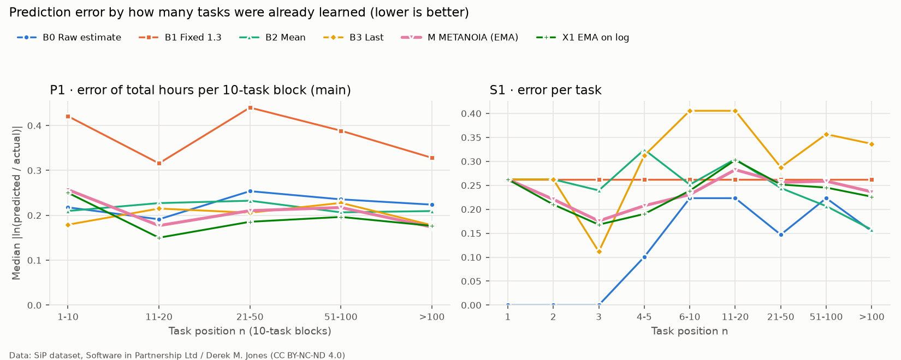
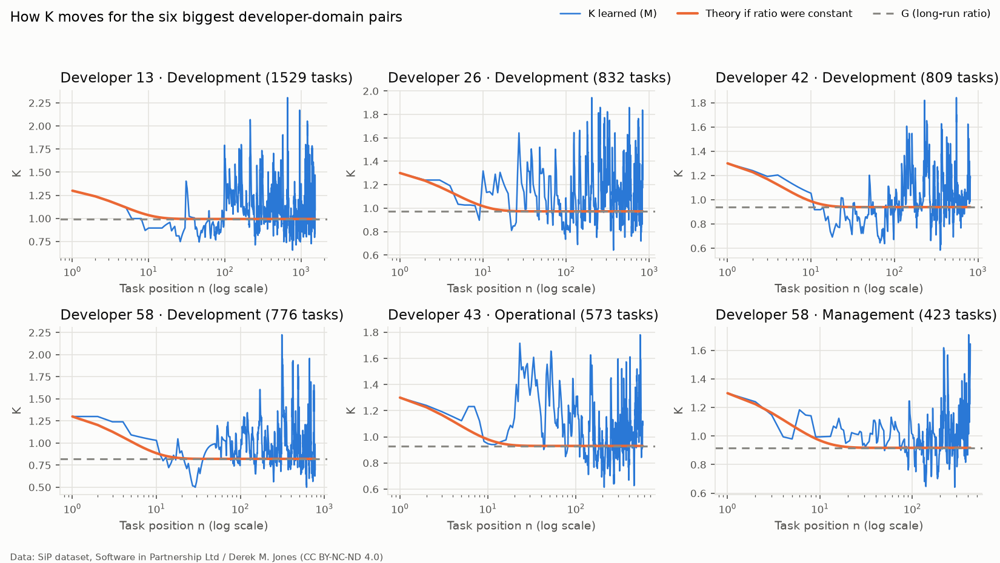
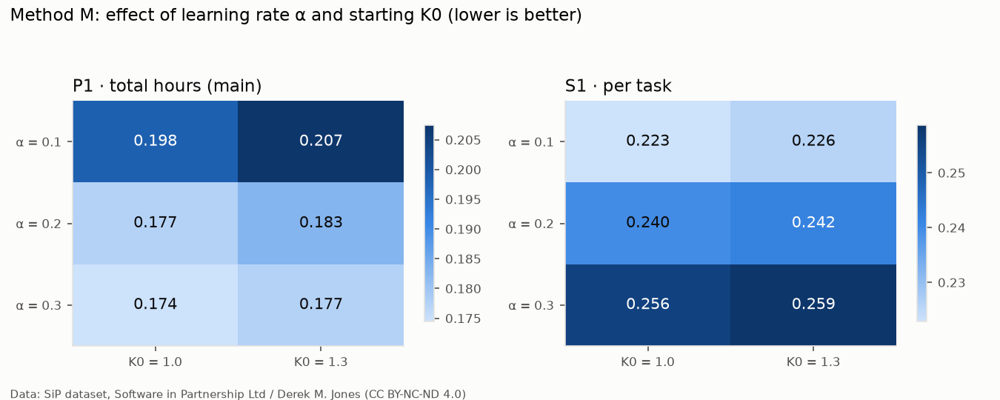

# K_bias learning replayed on the SiP dataset

METANOIA learns how much each user under- or over-estimates their work and corrects
future schedules: `T_proposed = T_est × K`, with K updated after every finished task by
`K_new = α × (T_act / T_est) + (1 − α) × K_old` (α = 0.2, K₀ = 1.3, K clamped to [0.5, 3.0]).
This report replays real estimate/actual pairs from the public SiP dataset through
**the production code** (`metanoia_ai.domain.kbias`) to check that this learning works.

Data: SiP dataset, Software in Partnership Ltd / Derek M. Jones, licensed CC BY-NC-ND 4.0
(<https://github.com/Derek-Jones/SiP_dataset>; D. M. Jones and S. Cullum, *A conversation
around the analysis of the SiP effort estimation dataset*, arXiv:1901.01621).
Reproduce: `uv run python -m research.kbias_sip.run --data <SiP folder> --out research/kbias_sip/results`
(no randomness; two runs give byte-identical CSV and PNG files).

## 1. Questions

SiP records what each developer estimated and what the task really took. It does not
record a "true speed" for each developer, so we cannot ask whether K reaches that speed.
We ask two questions we can measure:

- **Q1 – Convergence.** After how many tasks does K stay close to the developer's
  long-run estimation bias (per type of work)?
- **Q2 – Usefulness.** Compared with trusting the estimate as it is, and with other
  simple rules, how much closer does `T_est × K` get to the **total hours of a group of tasks**?

## 2. Data

SiP holds tasks done by 22 developers at one UK software company from 2004 to 2014.
Every task has an estimate (`HoursEstimate`) and the hours actually worked (`HoursActual`).

| Step | Left |
|---|---|
| All rows | 12,299 |
| Drop tasks with more than one developer (1,384 tasks) | 8,882 tasks |
| Keep finished work: `StatusCode` ∈ {FINISHED, COMPLETED, RELEASED} | **7,176 tasks** (20 developers) |
| (developer, `Category`) pairs | 39 pairs; **24 pairs with ≥ 10 tasks (7,133 tasks, 11 developers)** |
| (developer, `SubCategory`) pairs | 163 pairs; 70 pairs with ≥ 10 tasks (6,875 tasks) |

- **Multi-developer tasks are dropped.** Their estimate covers the whole task, but the actual
  hours are summed over everyone, so the bias of one person cannot be separated.
  METANOIA is also one person per task.
- **Statuses.** The paper (§2.2) gives the task life cycle as
  `ESTIMATED → AUTHORISE → CHRONICLE → COMPLETED → RELEASED → FINISHED`. CHRONICLE
  tasks are still being worked on (actual hours still growing), so we drop them. COMPLETED,
  RELEASED and FINISHED tasks are all done.
- **User and domain.** User = `DeveloperID`. Domain = `Category` (Development /
  Management / Operational) in the main run, and the finer `SubCategory` in a sensitivity run.
- **Order.** Tasks are replayed in order of `EstimateOn`, ties broken by task number.
- **Units.** SiP uses hours and METANOIA uses minutes. Only the ratio T_act / T_est matters, so the unit makes no difference.

**SiP developers mostly over-estimate.** The median ratio T_act / T_est is 1.00 and the
geometric mean is 0.88. 34% of tasks finished faster than estimated, 42% took exactly the
estimate and 24% took longer. This is the opposite of the usual planning fallacy,
and it is why the starting value K₀ = 1.3 is wrong for this population.

## 3. Method

**Replay rule (no look-ahead).** Each (developer, domain) pair is replayed task by task. For
task n, the method first predicts `T_est × k`, using only tasks 1…n−1. Only then does it learn
from task n. Tasks whose ratio is outside [1/5, 5] (4.3%) are predicted and scored but not learned from,
exactly as in production (`skip_reason`). Buffer = 0 (SiP has no breaks between tasks).

| Code | Method | Coefficient k |
|---|---|---|
| B0 | Raw estimate | always 1.0 (trust the user) |
| B1 | Fixed 1.3 | always 1.3 (literature constant, no learning) |
| B2 | Mean | geometric mean of all learned ratios (1.3 before the first) |
| B3 | Last | ratio of the last learned task (1.3 before the first) |
| **M** | **METANOIA** | production EMA: `update_k_bias`, α = 0.2, K₀ = 1.3 |
| X1 | EMA on log ratio | `ln K ← α ln r + (1 − α) ln K`; **exploratory, not production** |

All learned coefficients (B2, B3, M, X1) are clamped to [0.5, 3.0].

**Metrics.** The error of one prediction is `e = ln(predicted / actual)`, so over- and
under-estimating by the same factor count the same. 0.18 ≈ 20% off, 0.22 ≈ 25% off.

| Metric | Definition |
|---|---|
| **P1 (main)** | Split each pair into consecutive blocks of 10 tasks; per block `|ln(Σ predicted / Σ actual)|`; median over blocks (a last block shorter than 10 is dropped) |
| S1 | median (and mean) of `|e|` per task |
| S2 | mean `e` (bias; 0 is best, positive = over-estimates) |
| S3 | PRED(25): share of tasks within ±25% of actual |
| C1 | `d_n = |ln K_n − ln G|`, where G is the pair's geometric-mean ratio over all its learned tasks (uses the future; descriptive only) |

Only pairs with ≥ 10 tasks are scored. Each metric is also reported as the median of
per-developer values ("per dev"), so that one large developer cannot dominate the result.

**Why P1 is the main metric.** METANOIA fills a day or a week with several tasks. The schedule
breaks when the **total** is wrong, not when one task is off and another evens it out.
*Note for transparency:* P1 was chosen after a first trial run had shown that M loses to B0
per task but wins on block totals. For that reason every per-task metric is reported below as well.

## 4. Results (main run: Category, 24 pairs, 7,133 tasks)

### 4.1 Overall

| Method | P1 ↓ | P1 per dev ↓ | S1 median ↓ | S1 mean ↓ | S2 bias | S3 PRED(25) ↑ |
|---|---|---|---|---|---|---|
| B0 Raw | 0.226 | 0.249 | **0.158** | **0.386** | +0.126 | **0.576** |
| B1 Fixed 1.3 | 0.340 | 0.455 | 0.262 | 0.540 | +0.388 | 0.141 |
| B2 Mean | 0.211 | 0.229 | 0.183 | 0.401 | **+0.058** | 0.566 |
| B3 Last | 0.187 | 0.224 | 0.336 | 0.502 | +0.090 | 0.444 |
| **M METANOIA** | 0.183 | 0.219 | 0.242 | 0.441 | +0.166 | 0.507 |
| X1 EMA on log | **0.177** | **0.179** | 0.235 | 0.425 | +0.070 | 0.529 |

Per-developer medians (11 developers) for the per-task metrics: S1 median B0 0.223, M 0.292, X1 0.270; S3 B0 0.543, M 0.456, X1 0.478.

### 4.2 By task position n

P1 by block (count = number of 10-task blocks):

| Tasks | 1–10 | 11–20 | 21–50 | 51–100 | > 100 |
|---|---|---|---|---|---|
| B0 | 0.218 | 0.191 | 0.254 | 0.236 | 0.224 |
| B1 | 0.421 | 0.316 | 0.440 | 0.388 | 0.328 |
| B2 | 0.210 | 0.227 | 0.232 | 0.207 | 0.209 |
| B3 | **0.179** | 0.215 | 0.206 | 0.228 | 0.178 |
| M | 0.257 | 0.177 | 0.210 | 0.217 | **0.174** |
| X1 | 0.250 | **0.150** | **0.186** | **0.196** | 0.177 |
| blocks | 24 | 22 | 54 | 73 | 530 |

75% of tasks sit at position n > 100, so the overall numbers mostly describe long-term use.

### 4.3 Convergence of K (C1)

Median `d_n = |ln K_n − ln G|` for the learning methods:

| n | 1 | 2 | 3 | 4–5 | 6–10 | 11–20 | 21–50 | 51–100 | > 100 |
|---|---|---|---|---|---|---|---|---|---|
| M | 0.332 | 0.246 | 0.230 | 0.168 | 0.149 | 0.134 | 0.142 | 0.111 | 0.117 |
| X1 | 0.332 | 0.238 | 0.192 | 0.149 | 0.133 | 0.100 | 0.133 | 0.111 | 0.103 |
| B2 | 0.332 | 0.200 | 0.160 | 0.198 | 0.131 | 0.076 | 0.084 | 0.071 | 0.016 |
| B3 | 0.332 | 0.200 | 0.114 | 0.160 | 0.232 | 0.185 | 0.193 | 0.197 | 0.142 |

Pairs still present: 24 at n = 1…10, 13 at n = 100, 9 at n = 300, 3 at n = 800.
Theory (constant ratio, α = 0.2): the gap shrinks as `(1 − α)ⁿ`, so after 5 tasks
it is 33% of the start and after 10 tasks 11%.
B2 approaching 0 is expected by construction: G is defined as the same geometric mean that B2 computes.

### 4.4 Sensitivity

**α × K₀ for M** (P1 / S1):

| | K₀ = 1.0 | K₀ = 1.3 (production) |
|---|---|---|
| α = 0.1 | 0.198 / **0.223** | 0.207 / 0.226 |
| α = 0.2 (production) | 0.177 / 0.240 | 0.183 / 0.242 |
| α = 0.3 | **0.174** / 0.256 | 0.177 / 0.259 |

**Domain = SubCategory** (70 pairs, 6,875 tasks; P1 / S1): B0 0.201 / 0.163 · B1 0.302 / 0.262 ·
B2 0.192 / 0.207 · B3 **0.149** / 0.318 · M 0.159 / 0.244 · X1 0.152 / 0.229.

**Without tasks whose actual equals the estimate** (21 pairs, 4,115 tasks; P1 / S1):
B0 0.287 / 0.470 · B1 0.415 / 0.550 · B2 0.273 / **0.469** · B3 0.238 / 0.560 ·
M 0.239 / 0.503 · X1 **0.237** / 0.474.

## 5. Answers

**Q1 – Convergence.** K moves quickly at first. The median distance to the developer's
long-run bias falls from 0.33 to about 0.15 within 5–10 tasks and to about 0.13 by 20 tasks,
close to the theoretical curve (fig. 1). After that it **does not keep shrinking**: it stays
around 0.11–0.14 (≈ 12–15%). The reason is that SiP ratios are very noisy, and with α = 0.2 every
task moves K by a fifth of its surprise, so K keeps moving around G instead of settling.
This is the usual trade-off of an EMA: a smaller α (0.1) gives a steadier K and better
per-task error (S1 0.223), but follows changes more slowly and is worse on totals (P1 0.198).
In plain words: **about 10 tasks per type of work are enough for K to learn the direction and
size of a person's bias. More tasks do not make it more precise, because the person's own
variation sets the limit.**

**Q2 – Usefulness.**
- **For the total hours of a block of tasks, learning helps.** M is 19% more accurate than
  trusting the raw estimate (P1 0.183 vs 0.226), and 12% more accurate per developer
  (0.219 vs 0.249). The gain holds in every block after the first 10 tasks, with the finer
  SubCategory domains (0.159 vs 0.201), and without the copied-estimate tasks (0.239 vs 0.287).
- **No single constant fits everyone.** Multiplying every estimate by 1.3 (B1) is the worst
  method on every metric (P1 0.340), because these developers over-estimate. Starting from
  1.3, M still corrects itself in the right direction. This supports learning K for each person
  instead of using a fixed value from the literature.
- **For a single task, the raw estimate is better in SiP.** M is worse on S1 (0.242 vs 0.158), S3 and bias.
  Most of B0's advantage comes from the 42% of tasks whose actual equals the estimate (see limitations).
  Without them, B0, B2 and X1 are almost tied (S1 0.470 / 0.469 / 0.474) and M is slightly behind (0.503).
- **During the first 10 tasks M is worse than raw** (P1 0.257 vs 0.218), because K₀ = 1.3 points
  the wrong way for this population. With K₀ = 1.0 the same α gives P1 0.177.
- **X1 (EMA on the log ratio) is better than M on almost every metric**: P1 0.177 vs 0.183,
  P1 per dev 0.179 vs 0.219, bias +0.070 vs +0.166. The plain EMA averages ratios, so a few
  large overruns pull K up. Averaging their logarithms treats "twice as long" and "half as long"
  symmetrically. Production is **not** changed by this study; the question is raised separately.

## 6. Limitations

1. **Company developers, not freelancers.** SiP is one company's staff, working on client work with a
   sign-off process. What is tested here is the **algorithm for learning one person's estimation bias**,
   not the behaviour of METANOIA's users. We know of no public freelancer dataset with estimate/actual pairs.
2. **Reverse planning fallacy.** SiP developers mostly over-estimate (geometric mean 0.88),
   while METANOIA's K₀ = 1.3 assumes the usual under-estimation. Results on early tasks
   would likely look different for a population that under-estimates.
3. **Copied actuals.** 42% of tasks have actual hours exactly equal to the estimate, which
   suggests that hours were often booked to the estimate rather than measured. This flatters
   the raw estimate (B0). The sensitivity run without these tasks is reported above. This is also
   why METANOIA measures actual time with a timer instead of asking the user.
4. **Order approximated by estimate date.** `CompletedOn` is missing for 2,586 rows, so tasks are
   ordered by `EstimateOn` (always present). Within a (developer, Category) pair, 51% of tasks share
   their estimate date with another task of the same pair; their order is then by task number.
5. **Main metric chosen after a trial run.** P1 was chosen as the main metric after a trial showed
   that M wins on block totals but loses per task. All per-task metrics are reported in full so the
   reader can judge both.
6. **No single "converged at n".** The planned figure ("the n after which the median distance always
   stays ≤ 0.10") turned out not to be meaningful. K never stays within 10% because of noise; at large n
   only 1–3 pairs remain; and B0 would "converge" at n = 1 simply because G ≈ 1 in SiP.
   The distance curve is reported instead.
7. **Uneven pairs.** One pair has 1,529 tasks and 75% of tasks are at n > 100. Per-developer
   medians and per-n tables are given so the result does not rest on a few developers.

## 7. Files

| File | Content |
|---|---|
| `fig1_k_trajectory.png` | K of method M for the six biggest pairs, with G and the theoretical curve |
| `fig2_error_by_n.png` | P1 per block group and S1 per n group, one line per method |
| `fig3_sensitivity.png` | α × K₀ heat maps for M |
| `predictions.csv`, `summary.csv`, `sensitivity.csv` | Generated by the run; not committed (they reproduce licensed data) |

Every report or slide that uses these numbers must credit: *SiP dataset, Software in
Partnership Ltd / Derek M. Jones, CC BY-NC-ND 4.0.*
